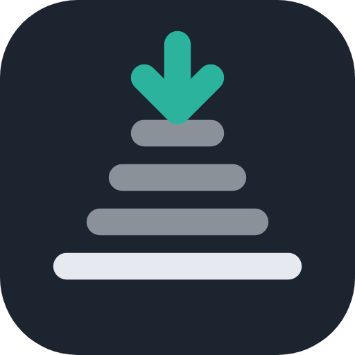
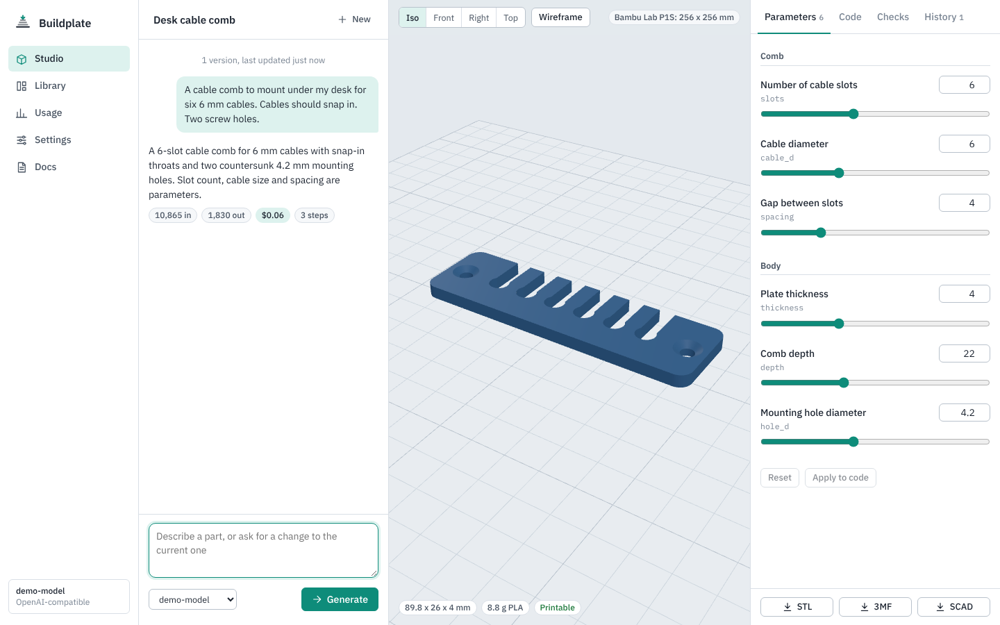
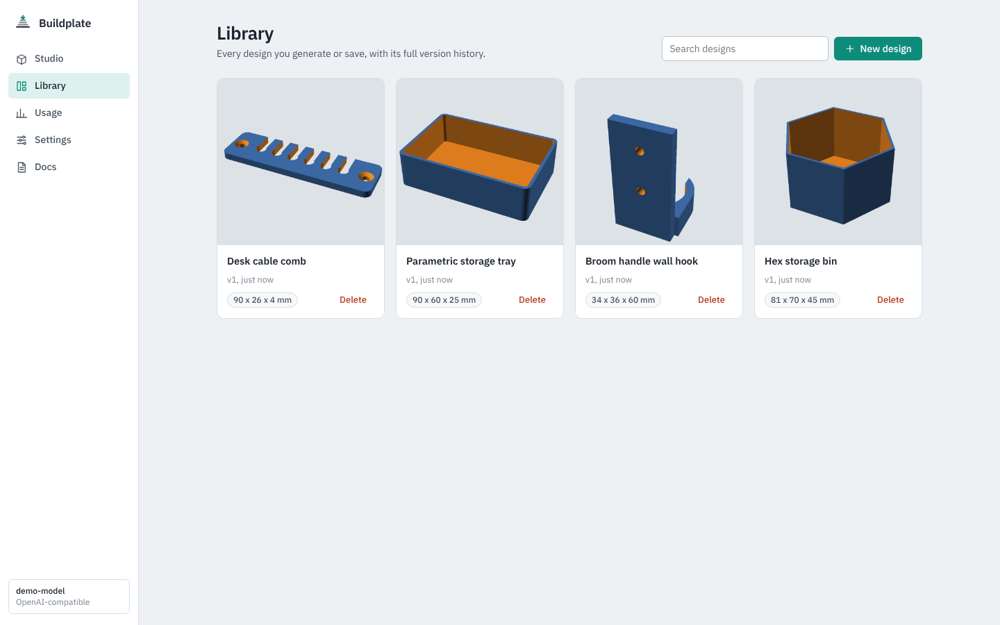
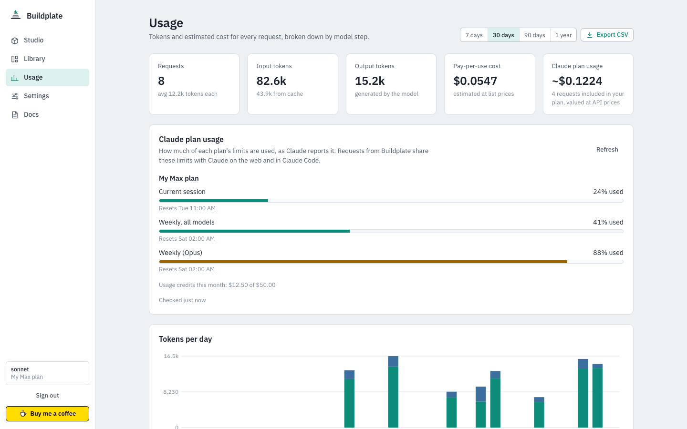
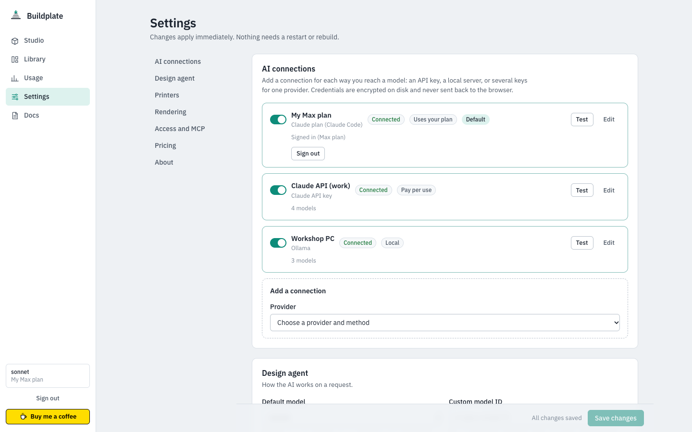
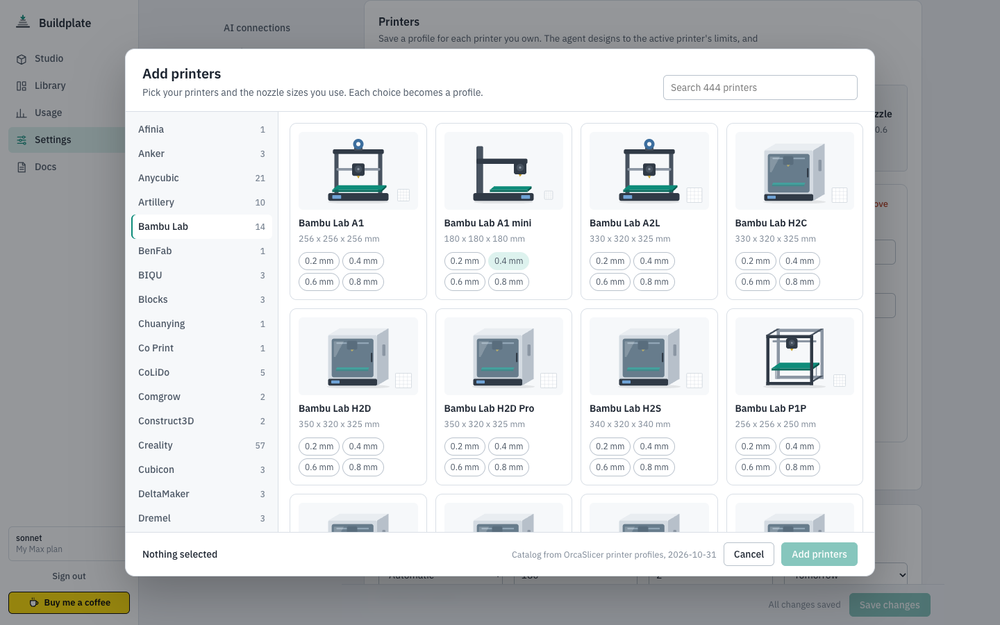
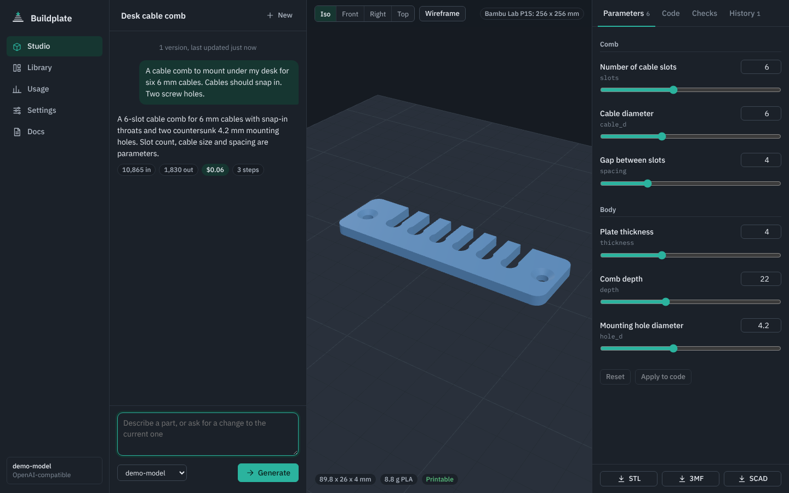

<p align="center">
  
</p>

<h1 align="center">Buildplate</h1>

<p align="center"><em>Describe a part. Print the part.</em></p>

<p align="center">
  <a href="https://github.com/rough-ton/buildplate/actions/workflows/build.yml"></a>
  <a href="https://github.com/rough-ton/buildplate/releases/latest"></a>
  <a href="https://github.com/rough-ton/buildplate/pkgs/container/buildplate"></a>
  
  <a href="LICENSE"></a>
</p>

> [!NOTE]
> **Active development:** Buildplate is pre-1.0. Expect changes between releases, and
> read the release notes before updating. Please
> [report problems](https://github.com/rough-ton/buildplate/issues/new) you run into.

Buildplate is a self-hosted AI design studio for 3D printing. Describe what you need and it
writes parametric OpenSCAD, renders it, checks the mesh against your printer, looks at the
result, fixes what is wrong and puts a ready-to-slice STL or 3MF on your build plate. It runs
as a single Docker container and works with the AI you already use: an API key, a local
model, or your Claude plan.



## Features

- **One container, nothing to install.** OpenSCAD with the Manifold engine, headless
  rendering, BOSL2 and MCAD, the backend, the web UI and the MCP endpoint are all in the
  image.
- **A design loop that checks its own work.** The agent renders every draft, validates it
  (watertight, on the bed, inside your build volume) and, with vision-capable models,
  reviews a four-view preview before saving.
- **Bring any model.** Claude, OpenAI, Gemini, OpenRouter (with one-click sign-in), xAI, Mistral,
  Groq, DeepSeek, Ollama, LM Studio, vLLM and other OpenAI-compatible servers, or your own cloud
  account on Amazon Bedrock, Google Vertex AI, Azure OpenAI or Microsoft Foundry. Add several
  connections per provider and switch models per request.
- **Use your Claude plan.** Design with your Claude Pro, Max, Team or Enterprise plan
  instead of an API key. Buildplate runs Claude Code, Anthropic's own app, and you sign in
  through Claude Code's own login; Buildplate never sees your Claude credentials.
- **Every major printer.** A catalog of 400+ printers from about 70 manufacturers, with
  the nozzle sizes you use. The plate, checks and design limits follow the printer you
  pick, including round beds for deltas.
- **Live parameters.** Customizer variables become sliders. Drag one and the part
  re-renders in seconds without spending a token.
- **Library and search.** Every generation and edit is a version you can reopen and
  export. Search by title, description, tags, prompt, model, size or date, and see which
  model made each design.
- **Token and cost tracking.** Every request shows its tokens and cost, with a per-step
  breakdown, daily charts, per-model totals, Claude plan limits and CSV export.
- **MCP endpoint.** Use the renderer, validator, library and design agent from Claude
  Desktop, Claude Code or any MCP client.
- **Configured in the browser.** Connections, models, printers and limits are set in the
  web UI and apply immediately, with credentials encrypted at rest.

## Install

Buildplate is published to the GitHub Container Registry. You never need to build it.

```bash
docker run -d --name buildplate \
  -p 8080:8080 \
  -v buildplate-data:/data \
  --add-host=host.docker.internal:host-gateway \
  --restart unless-stopped \
  ghcr.io/rough-ton/buildplate:latest
```

Prefer Compose? Use [docker-compose.yml](docker-compose.yml). On Unraid, use the
[Unraid template](deploy/unraid/buildplate.xml) and the [Unraid guide](docs/unraid.md).

| Image tag | What it tracks |
| --- | --- |
| `latest` | The newest release |
| `0.4`, `0.4.1` | A release line, or one exact release, for updating deliberately |
| `edge` | The latest commit on `main` that passed tests. For trying unreleased changes |

<details>
<summary>Updating</summary>

```bash
docker pull ghcr.io/rough-ton/buildplate:latest
docker stop buildplate && docker rm buildplate
# then run the same docker run command again; /data is kept
```

With Compose: `docker compose pull && docker compose up -d`.

Releases promote the exact image that passed tests on `main`, and settings and the
library database are migrated automatically on first start.

</details>

## Quick start

1. Open `http://<your-host>:8080`.
2. Set a password in **Settings > Access and MCP**. Buildplate asks for one before you add
   AI connections, because they hold credentials.
3. In **Settings > AI connections**, add an API key, point Buildplate at Ollama, or sign in
   with your Claude plan.
4. Pick your printer from the catalog, then describe your first part in **Studio**.

The [Getting started](docs/getting-started.md) guide walks through each step.

## Documentation

The same guides are built into the app under **Docs**.

| Guide | What it covers |
| --- | --- |
| [Getting started](docs/getting-started.md) | Install, first run, first design |
| [AI connections](docs/providers.md) | Connecting each provider, your Claude plan, choosing models, local models |
| [Using Studio](docs/using-studio.md) | Prompting, parameters, code editing, versions, tags, Library search, exports |
| [Token usage and cost](docs/token-usage.md) | What is counted, how cost is estimated, Claude plan usage |
| [MCP integration](docs/mcp.md) | Claude Desktop, Claude Code and other MCP clients |
| [Unraid](docs/unraid.md) | Template install, paths, permissions, reverse proxy |
| [Configuration reference](docs/configuration.md) | Every setting and environment variable |
| [Security](docs/security.md) | Passwords, tokens, credential storage, the Claude Code sandbox, exposure |
| [REST API](docs/api.md) | Endpoints for scripting and integrations |
| [Troubleshooting](docs/troubleshooting.md) | Common problems and fixes |

## How it works

```
 Browser (Studio, Library, Usage, Settings)          MCP clients
            |                                             |
            v                                             v
 +--------------------------------------------------------------------+
 |  Buildplate container                                              |
 |                                                                    |
 |  FastAPI ---- Design agent ---- LiteLLM --------> your AI provider |
 |    |              |       \                                        |
 |    |              |        `-- Claude Code ----> your Claude plan  |
 |    |              v                                                |
 |    |        OpenSCAD (Manifold) + Xvfb  ->  STL / 3MF / PNG        |
 |    |              |                                                |
 |    |              v                                                |
 |    |        Mesh checks (trimesh)                                  |
 |    v                                                               |
 |  /data: settings (credentials encrypted), SQLite library and       |
 |         usage, render cache, your OpenSCAD libraries               |
 +--------------------------------------------------------------------+
```

Settings are read on every request, so changes made in the UI take effect immediately.
Claude plan requests run Claude Code with all of its own tools turned off; it can only call
Buildplate's render-and-check tools. See [Security](docs/security.md).

## Screenshots

| Library | Usage |
| --- | --- |
|  |  |

| AI connections | Printer catalog |
| --- | --- |
|  |  |

| Dark mode | |
| --- | --- |
|  | |

## Support

Buildplate is an open-source project by Mike Roughton ([about.mroughton.com](https://about.mroughton.com)),
released under the MIT license. If you like this project and it saves you time at the printer,
please consider supporting its development with a coffee.

<a href="https://www.buymeacoffee.com/mikeroughton" target="_blank"></a>

## Contributing

Issues and pull requests are welcome. [CONTRIBUTING.md](CONTRIBUTING.md) covers running
from source, tests and the release process. To report a security problem, use
[private vulnerability reporting](https://github.com/rough-ton/buildplate/security/advisories/new)
instead of opening a public issue.

## License

Buildplate is released under the [MIT license](LICENSE). Bundled third-party components
keep their own licenses: OpenSCAD (GPL-2.0, run as a separate program), printer catalog
data derived from [OrcaSlicer](https://github.com/SoftFever/OrcaSlicer) profiles
(AGPL-3.0), BOSL2 (BSD-2-Clause), MCAD (LGPL-2.1), three.js (MIT), CodeMirror (MIT),
marked (MIT), xterm.js (MIT) and IBM Plex (OFL-1.1). Claude Code is not bundled: when you
add a Claude plan connection, it is downloaded from Anthropic and used under Anthropic's
terms.
